<p align="center">
  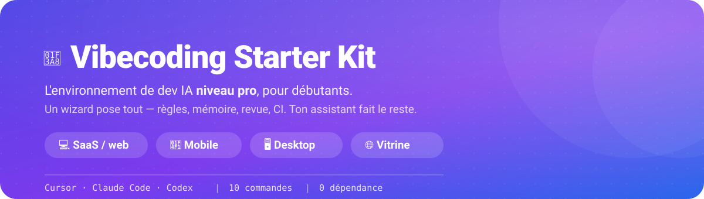
</p>

<p align="center">
  <a href="#-démarrage-rapide"><strong>Démarrage rapide »</strong></a>
  ·
  <a href="#-les-commandes">Les commandes</a>
  ·
  <a href="guides/glossaire.md">📖 Le glossaire du vibecodeur</a>
  ·
  <a href="https://github.com/ohvignas/vibecoding-starter-kit/issues">Signaler un bug</a>
</p>

<p align="center">
  <a href="https://github.com/ohvignas/vibecoding-starter-kit/actions"></a>
  <a href="https://www.npmjs.com/package/create-vibecoding-kit"></a>
  <a href="LICENSE"></a>
  
  
  <a href="http://makeapullrequest.com"></a>
</p>

---

## 🧭 C'est quoi ce kit, en une minute

**Tu ne sais pas coder ? C'est fait pour toi.**

Le **vibecoding**, c'est décrire ce que tu veux dans ta langue, et laisser une IA écrire le code. Ça marche étonnamment bien… à une seule condition : que l'IA ait le **bon contexte**.

<p align="center">
  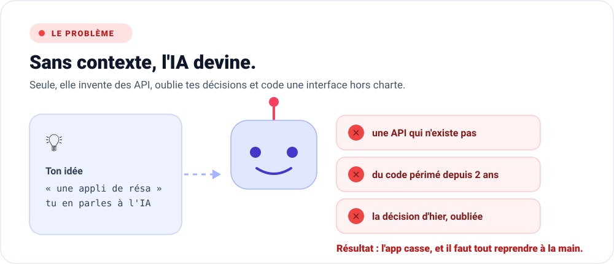
</p>

**Le problème.** Laisse l'IA seule, et elle devine. Elle te sort une fonction qui n'existe plus depuis deux ans, elle oublie ce que vous avez décidé hier, elle dessine des écrans qui ne ressemblent à rien. Ce n'est pas qu'elle est mauvaise : elle n'a **aucun cadre**.

<p align="center">
  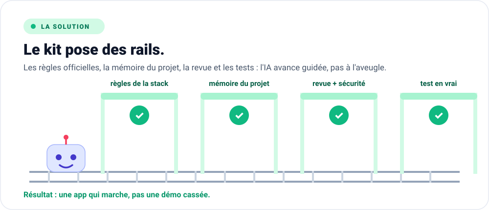
</p>

**La solution.** Ce kit installe ce cadre **à ta place**. D'un coup, ton assistant reçoit : les règles officielles de ta techno, une mémoire qui ne s'oublie pas, des vérifications automatiques, et une équipe d'agents qui relisent et testent. L'IA avance **guidée**, plus à l'aveugle.

<p align="center">
  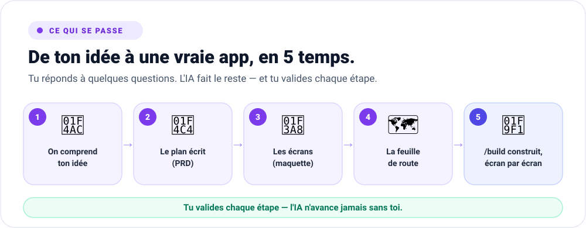
</p>

**Ce qui se passe.** Tu décris ton idée. L'IA comprend, écrit un plan, dessine les écrans, en tire une feuille de route — puis construit tout, **écran par écran**, en te montrant le résultat à chaque fois.

**Tous les plans, puis le build.** À la fin de la feuille de route, l'IA écrit **un plan par jalon** (toute l'app, d'un coup) — chaque plan charge les **skills officiels** et les **docs à jour**, et s'appuie sur la maquette si elle existe. Ensuite `/build` **enchaîne les jalons jusqu'au bout**.

<p align="center">
  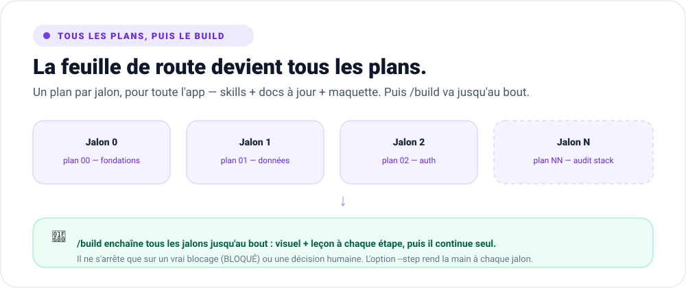
</p>

<p align="center">
  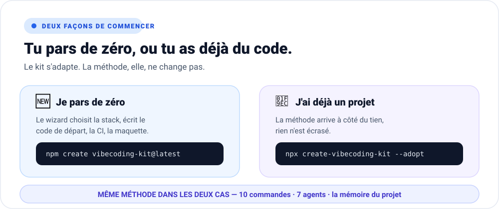
</p>

**Le point d'étape, d'abord.** Quand tu dis « installe le projet », l'IA ne fonce pas : elle **liste ce qui est déjà là et ce qui manque**, te montre la liste, et **attend ton accord**. Projet neuf comme projet existant : rien ne part à moitié, aucune étape sautée en silence.

<p align="center">
  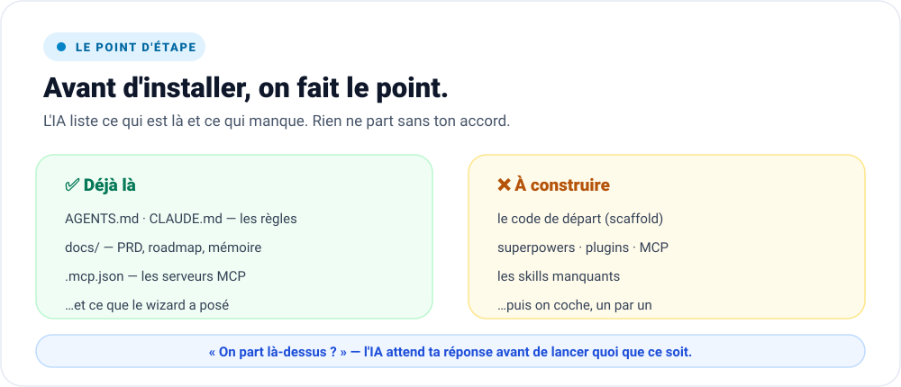
</p>

> **Une seule commande à retenir : `/help`.** Elle te dit toujours par où continuer.
>
> Et c'est la **même méthode** pour Cursor, Claude Code et Codex : le projet reste portable d'un assistant à l'autre.

## ✨ Fonctionnalités

| | Fonctionnalité | Ce que ça fait |
|---|---|---|
| 🚀 | **10 commandes** | de l'idée (`/new-project`) à la mise en ligne (`/deploy`) — la liste complète est plus bas |
| 🪜 | **Runbooks en étapes** | les commandes longues arrivent en **fichiers séparés**, un par étape, avec une checklist d'entrée. L'IA en ouvre une à la fois — elle n'en saute plus, et tu vois où tu en es |
| 🧩 | **Environnement par stack** | selon la stack, le projet est câblé auto avec les **plugins + MCP + skills + hooks** du framework |
| 💳 | **Catalogue de domaines** | paiement, email, storage, analytics, erreurs, push… **choisis d'après le PRD** (`docs/DOMAINS.md`), pas tout d'un coup |
| 🧠 | **Mémoire auto-croissante** | un « cerveau du projet » dans `docs/memory/`, nourri à chaque session et rechargé au démarrage → l'IA ne refait pas ses erreurs |
| 🛡️ | **Revue + sécu + test** | une **équipe de 7 agents** : `verificateur` (le juge : PROUVÉ / NON PROUVÉ / BLOQUÉ) · `code-reviewer` · `security-reviewer` · `test-runner` · `critique-produit` · `critique-donnees` · `critique-ux` |
| 🧪 | **Test complet (design + fonctionnel)** | après **chaque** implémentation : test auto + navigateur & screenshot, **et** le parcours refait en vrai (Playwright web · Maestro mobile · Chrome DevTools desktop) |
| 📏 | **Règles permanentes** | injectées dans `AGENTS.md` : sous-agents, vérification, secrets & coûts, CSS-maquette, design et accessibilité |
| 🤖 | **Multi-assistant** | Cursor, Claude Code et Codex — les mêmes règles marchent partout |
| 🎨 | **Design-first → maquette** | on fixe d'abord le design system (`docs/design.md`), **puis** la maquette (un sous-agent par écran). La **roadmap découle de la maquette validée** |
| 🎓 | **Mode apprentissage** | l'IA t'**explique** ce qu'elle fait et **pourquoi**, et écrit la leçon dans `docs/APPRENTISSAGE.md` : ce qu'on a fait, pourquoi ainsi, le mot du jour |
| 📐 | **On planifie à fond** | PRD + tech spec + design détaillés **avant** la moindre ligne de code, puis roadmap exhaustive |
| 🔀 | **Deux chantiers de front** | un worktree par chantier, la branche synchronisée avant de pousser, un seul serveur de dev partagé |
| 🆘 | **Filet de sécurité** | perdu → `/next` ; ça casse → `/sos` ; **3 tentatives** puis `BLOQUÉ` ; un point de restauration par jalon |
| 🚫 | **Anti-flemme (Règle Réalité)** | zéro mock, zéro `lorem`, zéro donnée en dur hors des tests : chaque écran lit et écrit dans le **vrai** backend |
| 📓 | **Journal du crew** | `docs/agents/JOURNAL.md`, `state.yaml` et `inventaire.md` : ce que les agents ont fait, où en est le projet, et ce qu'il reste à couvrir |
| 🧬 | **Projet existant (`--adopt`)** | `npx create-vibecoding-kit@latest --adopt`, lancé **depuis** ton projet : la méthode arrive **dans** ton `AGENTS.md` et ton `CLAUDE.md`, entre deux marqueurs. **Aucun fichier à toi n'est écrasé**, ton `package.json` non plus |
| 🪟 | **Fiable & multi-OS** | `git init` + hooks actifs + commit initial ; testé en CI sur Windows/macOS/Linux × Node 20.12/22 |
| 🔄 | **Mise à jour pro** | `npx create-vibecoding-kit --refresh` (avec `@latest`), depuis ton projet : régénère **tout ce qui est du kit** — règles, runbooks, agents, glossaire, docs de stack — **et met à jour tes skills** (design + stack + crew). Ta zone perso n'est **jamais** touchée |
| 🧭 | **Point d'étape** | avant d'installer, l'IA **liste ce qui est là et ce qui manque**, le montre, et **attend ton accord** — neuf comme projet existant : aucune étape sautée en silence |
| 🗺️ | **Tous les plans d'un coup** | la fin de la roadmap génère **un plan par jalon** (toute l'app), chacun avec **skills + docs à jour + maquette** ; puis `/build` enchaîne jusqu'au bout (`--step` pour reprendre la main) |
| 🎯 | **Pentest IA (optionnel)** | **Shannon** : un pentest IA web, en option — Action CI + SARIF, « pas d'exploit, pas de rapport ». **Jamais un prérequis** |
| 🧩 | **Installable en plugin** | le dépôt est aussi un **plugin** (dossier `plugin/`, trois formats) : Claude Code, Codex, Cursor — les 10 commandes + 7 agents + règles, sans scaffolder |
| 🚀 | **Déploiement VPS (Hostinger)** | un chemin **SSH complet** (durcissement, Docker, Caddy + HTTPS, DNS, sauvegardes) + les **skills officiels Hostinger** (`vps · dns · domains`) et les MCP optionnels. **Lien d'affiliation** : `AV10` = **10 % de réduction** |
| 🔎 | **SEO + GEO** | la stack vitrine sort optimisée Google **et** IA (sitemap, JSON-LD, llms.txt, robots IA-friendly) |

## ⚡ Démarrage rapide

<p align="center">
  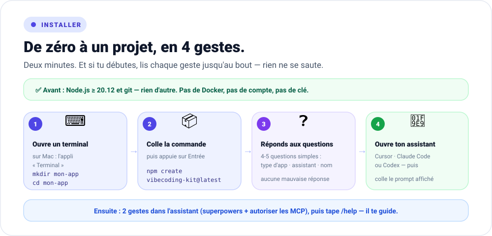
</p>

### 🆕 Cas A — tu pars de zéro

Dans un **dossier vide** :

```bash
npm create vibecoding-kit@latest
```

> **Prérequis : Node.js ≥ 20.12 + git.** Le wizard (l'assistant qui pose les questions) demande stack/assistant/nom (+ Convex cloud ou local pour le SaaS, + **mode apprentissage**), puis pose **tout** — fichiers, hooks, règles, commandes, mémoire, CI — et **installe les skills**. Aucun compte, aucune clé : quatre à cinq questions.
>
> **Stack vitrine** : Astro exige **Node ≥ 22.12**. Le wizard, lui, tourne dès 20.12.

### 🧬 Cas B — tu as déjà un projet

**Depuis le dossier de ton projet** (pas un dossier vide, pas un sous-dossier) :

```bash
npx create-vibecoding-kit@latest --adopt
```

> Même méthode — les 10 commandes, les 7 agents, la mémoire, les règles — mais le kit **ne revendique aucune techno** : ni stack, ni scaffold, ni CI, ni `maquette/`.
>
> Les règles arrivent **dans** ton `AGENTS.md` et ton `CLAUDE.md`, entre deux marqueurs : tout ce qui est dehors reste **à la ligne près**, et **aucun fichier à toi n'est écrasé**, ton `package.json` non plus.
>
> Et ensuite, ce n'est **pas** `/new-project` (il fonderait un PRD par-dessus un code qui existe déjà) : le point de départ, c'est **`docs/ETAT-DES-LIEUX.md`** — ton IA le remplit en lisant **ton** code.

**2. Ouvre ton assistant IA** dans le dossier et **colle le prompt** affiché par le wizard (aussi enregistré dans `COLLE-MOI-DANS-L-IA.md`).

**3. Tape `/help`** — l'aide-mémoire : les 10 commandes, et par où continuer.

## ✅ Après l'install — les 2-3 gestes qui restent

Le wizard a **déjà tout posé** (règles, 10 commandes, agents, skills, git + hooks, CI, config MCP). Il reste **trois gestes** dans ton assistant : un installeur ne peut pas brancher un plugin ni un compte à ta place. Ta liste exacte, cochable, est dans **`docs/A-FAIRE.md`** — selon ton couple **stack × assistant**, c'est de **0 à 2 plugins** et **4 à 6 serveurs MCP**.

### Geste 1 — installe superpowers (le pilote de la boucle)

| Assistant | Commande |
|---|---|
| Cursor | `/add-plugin superpowers` |
| Claude Code | `/plugin install superpowers@claude-plugins-official` |
| Codex | ouvre `/plugins`, cherche « Superpowers », installe |

Vérifie : tape `/brainstorm`. Si la commande est reconnue, c'est bon.

### Geste 2 — le plugin de ta stack *(si ton combo en a un)*

C'est le plugin propre à ta techno. Certains combos n'en ont **pas** — sur **Codex**, seule la stack Mobile en a un.

| Ta stack | Assistants qui ont un plugin |
|---|---|
| **SaaS** | Cursor, Claude Code |
| **Mobile** | Claude Code, Codex |
| **Desktop** | Claude Code |
| **Vitrine** | Cursor, Claude Code |

La commande exacte est dans `docs/A-FAIRE.md` § 1 (elle dépend de ton assistant).

### Geste 3 — autorise les MCP

| Ta stack | Serveurs MCP |
|---|---|
| **SaaS** | Convex · Better Auth · shadcn · Playwright *(test E2E)* · Context7 *(doc à jour, n'importe quelle lib)* |
| **Mobile** | Convex · Expo *(login requis)* · Maestro *(test E2E)* · Context7 *(doc à jour)* |
| **Desktop** | Chrome DevTools *(test E2E)* · shadcn · Electron · Context7 *(doc à jour)* |
| **Vitrine** | Astro Docs · Convex · Better Auth · shadcn · Playwright *(test E2E)* · Context7 *(doc à jour)* |

> [!TIP]
> **Bloqué ?** `/doctor` dit ce qui manque. **Coûts IA** → [`docs/COUTS.md`](docs/COUTS.md).
>
> **Mettre à jour un projet existant** : `npx create-vibecoding-kit --refresh` (`@latest` conseillé) — régénère **tout ce qui est du kit** (règles, runbooks **et leurs étapes**, agents, glossaire, `ai-context/`, hooks, `.mcp.json`) **et tes skills**. Tes docs et `src/` ne sont **jamais** touchés. `--dry-run` pour voir avant.

## 🎛️ Les commandes

| Commande | Rôle |
|---|---|
| **`/help`** | **L'entrée.** Les 10 commandes et « par où continuer » |
| **`/init-vibecoding`** | L'IA installe l'environnement (ou met à jour un projet existant) et déroule `docs/A-FAIRE.md` |
| **`/new-project`** | La fondation, en **9 étapes** : cadrage → **PRD** → **tech spec** → arborescence → **design + maquette** → roadmap → scaffold |
| **`/build`** | Construit la roadmap **jalon par jalon** (TDD), en relançant la vraie app et en la comparant à la maquette |
| **`/new-feature`** | Une feature isolée : story + critères → TDD → **test live** → sécu → PR |
| **`/edit-design`** | Charge les skills design + `docs/design.md` **avant** de toucher à l'interface |
| **`/doctor`** | Diagnostic : fichiers, MCP de la stack, hooks, secrets commités |
| **`/next`** | Ta **prochaine action**, d'après l'état du projet |
| **`/sos`** | Ça casse : réparer, mettre de côté, ou revenir au dernier point vert |
| **`/deploy`** | Mettre en ligne (gate CI verte + revue sécu) |

Les trois commandes longues ont un **dossier d'étapes** à côté : l'IA les ouvre une par une, jamais de mémoire.

## 🧱 Les 4 stacks

<p align="center">
  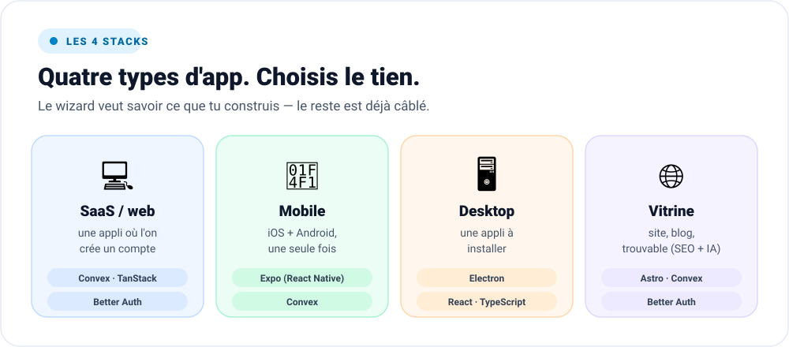
</p>

| Type d'app | Stack |
|---|---|
| 💻 **SaaS / web** | Convex + TanStack Start + Better Auth |
| 📱 **Mobile iOS/Android** | React Native (Expo) + Convex |
| 🖥️ **Desktop** | Electron |
| 🌐 **Vitrine** | Astro + shadcn/ui (site public) + TanStack Start + Convex + Better Auth (dashboard) — vitrine, portfolio, blog, SEO + GEO |

Chaque stack a son README débutant : [`stacks/saas/README.md`](stacks/saas/README.md), [`stacks/mobile/README.md`](stacks/mobile/README.md), [`stacks/desktop/README.md`](stacks/desktop/README.md), [`stacks/vitrine/README.md`](stacks/vitrine/README.md) — plus des **docs officielles vérifiées** et des prompts prêts à coller.

> [!IMPORTANT]
> **La stack Vitrine, c'est deux applications et un serveur — à savoir avant de la choisir.**
>
> `site/` sert les pages au public, `dashboard/` sert à les écrire, et les deux parlent au même Convex. Ça demande donc un **compte Convex** et un **VPS** (Docker) : ce n'est **pas** un site gratuit posé sur un hébergement statique.
>
> Et une propriété qu'il vaut mieux connaître dès le départ : **le site public lit Convex au build**, pas à chaque visite — c'est ce qui le rend rapide et indexable. Publier depuis le dashboard ne suffit donc pas : la page concernée doit être **purgée** pour être re-rendue.
>
> Pour un site qui change rarement et doit rester gratuit, un **Astro seul avec du contenu en Markdown** reste le bon outil.

## 🧠 Pourquoi ces technos ? (et ce qui t'aide)

<p align="center">
  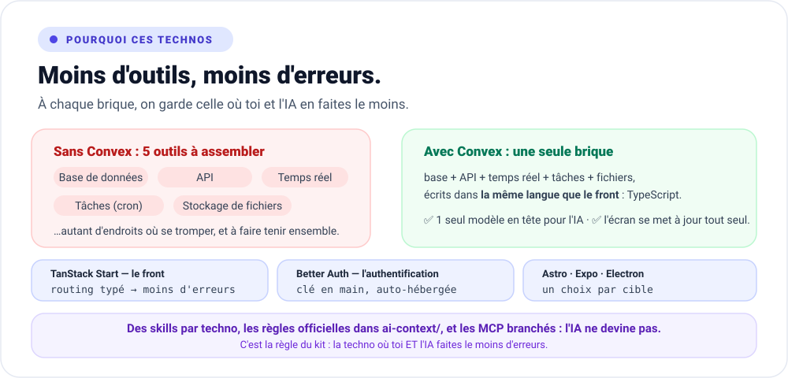
</p>

Chaque brique est choisie pour une raison **de débutant** : moins d'outils à assembler, et plus de choses que l'IA **ne peut pas casser**.

### 🗄️ Convex — la base de données ET le backend

**Pourquoi.** Convex remplace **cinq** outils par **un seul** : base de données + API + temps réel + tâches planifiées + stockage de fichiers. Tout s'écrit en **TypeScript** — la même langue que le front — donc l'IA a **un seul modèle en tête** au lieu de quatre. Et c'est **réactif** : une donnée change en base, ton écran se met à jour **tout seul**, sans code de rafraîchissement.

**Pourquoi pas Firebase ou Supabase ?** Ils te donnent une base *à côté* du backend — à toi d'ajouter les règles, les fonctions, le temps réel. Convex **fusionne** les deux : ta logique serveur *est* du TypeScript typé, déployé pour toi.

**Ce qui t'aide :** les **skills officiels Convex** (`convex-design` pour le schéma, `convex-authz` pour qui a le droit à quoi, `convex-optimize` pour la vitesse…), le **MCP Convex** (l'IA interroge ta **vraie** base), les règles officielles dans `ai-context/convex/`, et le skill **`convex-self-hosted`** si tu héberges sur ton VPS.

### 🧩 TanStack Start — le front (et le serveur web)

**Pourquoi.** C'est du **React** (le standard du métier) avec un **routing typé de bout en bout** : le routeur **vérifie** tes liens, tes paramètres d'URL et tes appels serveur. En vibecoding c'est décisif — une route mal orthographiée **ne compile pas**, au lieu de casser plus tard. SSR et fonctions serveur inclus.

**Pourquoi pas Next.js ?** Même famille (React full-stack, SSR). TanStack Start est plus **« le type d'abord »** — précisément l'avantage qui compte quand c'est une IA qui écrit.

**Ce qui t'aide :** le skill **`deckardger/tanstack-agent-skills`** (`tanstack-start`, `tanstack-router`, `tanstack-query` — **installé pour toi**), `ai-context/tanstack-start/llms.txt`, et les règles de stack livrées dans ton projet.

> ⚠️ **Pas de MCP TanStack** : le CLI a **retiré** son serveur MCP (`tanstack mcp` n'existe plus). À la place : `npx @tanstack/cli search-docs "…" --library start` pour la doc, et le MCP **Context7** pour tout le reste.

### 🔐 Better Auth — l'authentification

**Pourquoi.** Écrire l'authentification à la main est le chemin classique vers une **faille**. Better Auth donne comptes, sessions, 2FA, connexion Google/GitHub, organisations — **clé en main**, et **auto-hébergé** : tes utilisateurs vivent dans **ta** base Convex, pas chez un tiers payant.

**Ce qui t'aide :** le skill officiel **`better-auth/skills`** (bonnes pratiques, sécurité, email/mot de passe, organisations) et le **MCP Better Auth** (la doc en direct).

### 🌐 Astro · 📱 Expo · 🖥️ Electron

- **Astro** (vitrine) : des pages **statiques par défaut** — rapides, indexables par Google **et** par les IA. *Aide :* skill **`incluud/astro-agent-skills`** (bonnes pratiques, composants, collections) + **MCP Astro Docs** (officiel).
- **Expo** (mobile) : **une** base de code pour **iOS et Android** (React Native) — rien à apprendre en Swift ou Kotlin. *Aide :* skill **officiel `expo/skills`** (EAS, notifications, caméra…) + **MCP Expo**.
- **Electron** (desktop) : une appli **installable** (Windows, Mac, Linux) à partir de web — le chemin le plus court vers le bureau. *Aide :* skills **communautaires** Electron *(Claude Code)* + **MCP Chrome DevTools** et **Electron**.

> **La règle du kit, à chaque brique :** on ne cherche pas « la meilleure techno », mais **celle où toi et l'IA faites le moins d'erreurs**. D'où **TypeScript partout**, des **règles officielles** livrées dans `ai-context/`, et des **skills par techno** — installés pour toi.

## 🧠 La mémoire du projet & le journal du crew

<p align="center">
  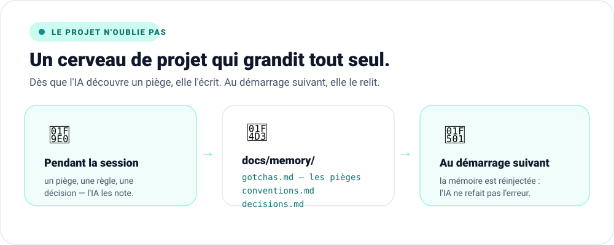
</p>

- **Mémoire** — un « cerveau du projet » dans `docs/memory/` : dès que l'IA découvre un piège, elle l'écrit ; au démarrage, un **hook** le réinjecte.
- **Consolidation** — quand l'index grossit, tu demandes à l'IA de **consolider** (dédoublonner, archiver). Ça se passe **dans le fil**, tu vois le diff.
- **Journal** — `docs/agents/JOURNAL.md` est **append-only** : une ligne par mission (`date · agent · mission · statut · preuve · décision`), jamais effacée.
- **État** — `docs/agents/state.yaml` dit **où en est le projet** (`status`, jalon et tâche en cours, `repair_attempts`, `blocked_reason`). Tout le monde le lit, **un seul agent l'écrit**.
- **Couverture** — `docs/agents/inventaire.md` liste **élément par élément** ce que la maquette et le PRD promettent, avec le jalon qui le rend fonctionnel.

### Les deux règles qui gouvernent tout

- **Règle Preuve** — on ne déclare pas, on **prouve**. Trois statuts : `PROUVÉ` (commande + sortie brute + code 0) · `NON PROUVÉ` · `BLOQUÉ`. Un agent ne prononce jamais `PROUVÉ` sur son propre code, et **3 tentatives** sur le même bug suffisent : à la 3ᵉ, `BLOQUÉ`.
- **Règle Réalité** — mieux vaut **lent et réel** que rapide et bidon : vraies données du vrai backend, chaque bouton câblé de bout en bout, la maquette reproduite à l'identique. Les mocks n'ont droit de cité que dans les tests.

## 🛡️ La sécurité — trois lignes de défense

<p align="center">
  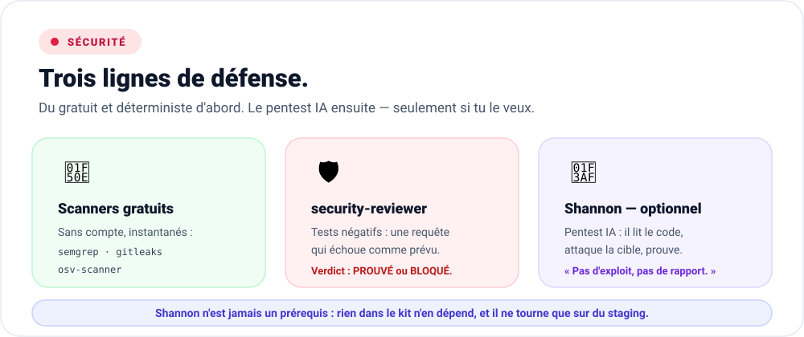
</p>

1. **Gratuit et déterministe d'abord** : `semgrep`, `gitleaks`, `osv-scanner` (optionnels, sans compte) plus le **scan de secrets** en CI et le hook pre-commit.
2. **La preuve par les tests négatifs** : l'agent **`security-reviewer`** rejoue une requête qui **doit échouer** (401/403, IDOR, XSS…) et rend un verdict **PROUVÉ / BLOQUÉ**.
3. **Le pentest IA, si tu le veux** : **[Shannon](https://github.com/KeygraphHQ/shannon)** attaque une cible de **staging**, lit ton code, et ne rapporte que ce qu'il peut **exploiter**. Action CI + SARIF. **Optionnel** — voir [`guides/04-pentest-shannon.md`](guides/04-pentest-shannon.md).

> Rien n'est exigé pour démarrer : le kit marche sans Docker ni clé. Shannon est une **escalade**, jamais un prérequis.

## 👥 L'équipe d'agents qui vérifie ton travail

<p align="center">
  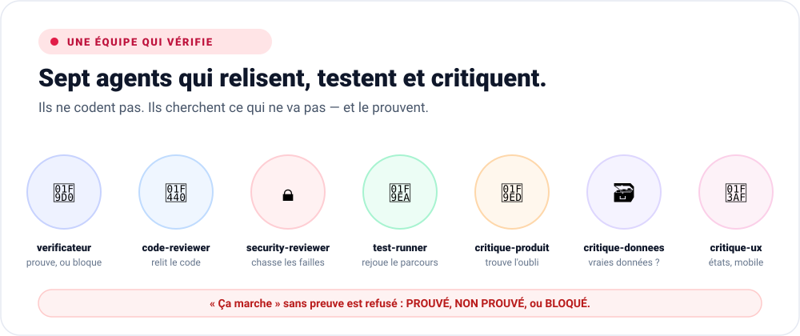
</p>

Ils ne codent pas : ils **cherchent ce qui ne va pas**, et le prouvent. Tu peux les appeler n'importe quand (« lance `critique-ux` sur cet écran »), pas seulement à la fin.

## 🔁 La boucle de travail

<p align="center">
  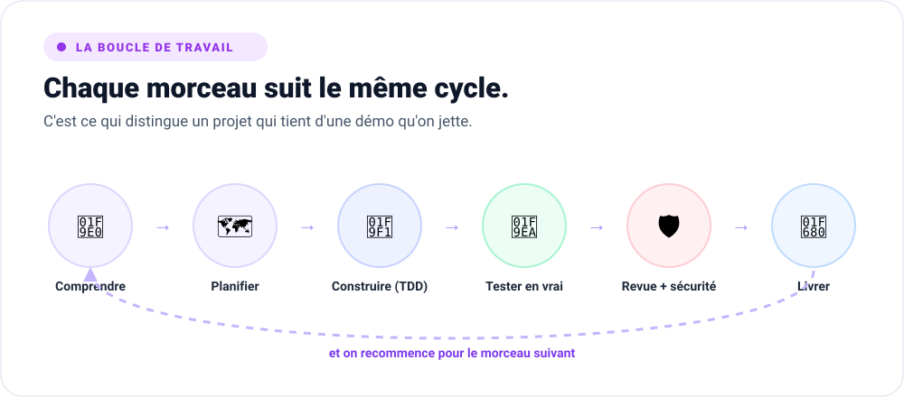
</p>

Le pilote est la boucle [superpowers](https://github.com/obra/superpowers) : `brainstorm → plan → exécution (sub-agents, TDD) → review → test live → sécu → commit → PR → CI → merge`. Elle est écrite dans l'`AGENTS.md` généré, donc toujours en contexte.

## 🆘 Le filet de sécurité

<p align="center">
  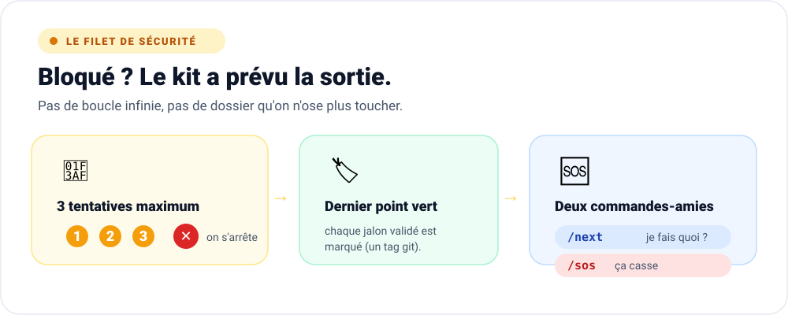
</p>

Perdu → **`/next`**. Ça casse → **`/sos`**. Bloqué trois fois sur le même bug → `BLOQUÉ`, et le piège part dans `docs/memory/gotchas.md`. Fini la boucle infernale.

## 🧩 Installer la méthode en plugin (sans créer de projet)

Tu veux juste les **10 commandes**, les **7 agents** et les **règles de stack** dans ton assistant, sans rien scaffolder ? Le dépôt **est** aussi un plugin : un seul dossier `plugin/` qui porte les **trois formats** (Claude Code, Cursor, Codex) et trois marketplaces.

**Claude Code**

```bash
claude plugin marketplace add ohvignas/vibecoding-starter-kit
claude plugin install vibecoding@vibecoding
```

**Codex**

```bash
codex plugin marketplace add ohvignas/vibecoding-starter-kit
# puis `/plugins` dans le CLI
```

**Cursor**

```bash
cp -r plugin ~/.cursor/plugins/local/vibecoding   # puis « Developer: Reload Window »
```

> Le plugin fournit la **méthode** ; il **ne scaffolde pas** (pas de git, CI, MCP, `maquette/`). Pour un projet complet : `npm create vibecoding-kit@latest`.

## 🚀 Déployer en ligne — et pourquoi on recommande Hostinger

<p align="center">
  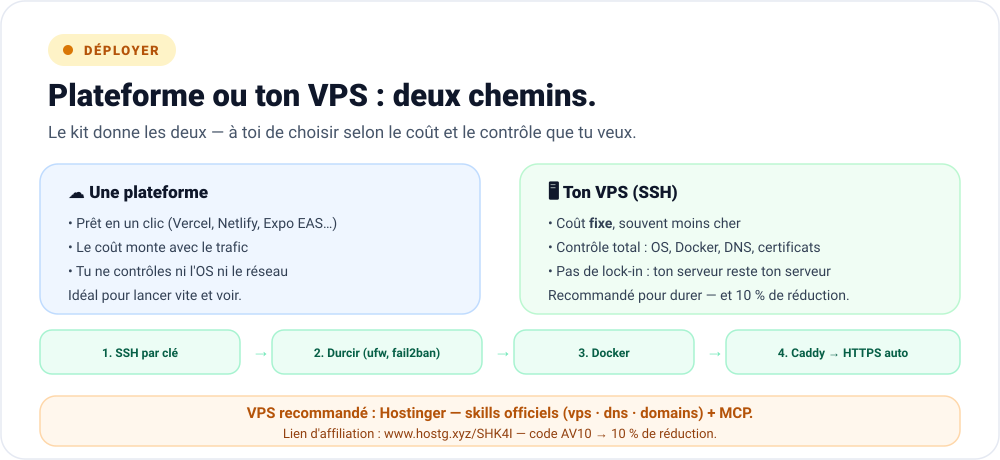
</p>

Tu veux **mettre ton app en ligne** ? Tu as **deux chemins**, et le kit te donne les deux :

| | Plateforme (Vercel / Netlify / EAS…) | **VPS (ton serveur)** |
|---|---|---|
| Mise en route | un clic | SSH, Docker — ~1 h la première fois |
| Coût | monte avec le trafic | **fixe**, souvent moins cher |
| Contrôle | limité | **total** : ton OS, ton Docker, ton DNS, tes certificats |
| C'est fait pour | lancer vite | **durer**, et tout maîtriser |

**Pour un VPS, on recommande Hostinger** — et avec le code `AV10`, tu as **10 % de réduction** (lien ci-dessous).

### Pourquoi Hostinger ?

- **Le plus simple à utiliser** : le VPS se crée en deux minutes, on colle sa clé SSH, et c'est connectable tout de suite — pas de formulaire interminable, pas de facture qui surprend.
- **Le meilleur rapport qualité/prix** : un VPS KVM (2 vCPU / 4 Go) pour quelques euros par mois, largement assez pour un SaaS qui démarre ou un site vitrine.
- **Pas de lock-in** : c'est un **vrai serveur Linux, en SSH**. Ton Docker, ton Caddy, tes certificats. Changer d'hébergeur un jour = changer une adresse IP, pas réécrire l'app.
- **Des skills et un MCP officiels** : `hostinger/hostinger-agent-skills` (VPS · DNS · domaines) et un MCP officiel — ton assistant pilote le serveur **sans deviner l'API**. Le kit les installe pour toi.
- **Une grande communauté** : quand tu bloques à 23 h, la réponse existe déjà.

> ⚠️ **Lien d'affiliation.** Antoine **n'est pas payé** pour mettre ce lien ici : il le recommande parce qu'il le trouve **simple, pas cher et cool**. Mais il touche une **commission** si tu passes par là — et **toi, tu as 10 % de réduction**.
>
> 👉 **https://www.hostg.xyz/SHK4I** — code **`AV10`** → **10 % de réduction**
>
> Quand tu demandes à ton assistant de **mettre ton app en ligne**, il **ouvre cette page** dans ton navigateur (il ne se contente pas de la citer) : tu prends ton VPS avec la réduction, et `/deploy` déroule le reste.

### Ce que le kit prépare pour toi

- **`/deploy`**, section « **VPS Hostinger (SSH)** » : clé SSH → **durcissement** (utilisateur non-root, `ufw`, `fail2ban`, mises à jour auto) → **Docker** → **Caddy + HTTPS automatique** → **DNS** → **sauvegardes** → **supervision**.
- Les **skills officiels Hostinger** sont **installés automatiquement** (`vps` · `dns` · `domains`) sur les stacks **saas** et **vitrine**.
- **Deux MCP optionnels** : l'officiel Hostinger (VPS/DNS/domaines) et **`ssh-mcp`** (commander le serveur) — **hors du projet**, jamais dans le dépôt (un jeton et un accès SSH ne se commitent pas).
- **`docs/A-FAIRE.md`** te le rappelle **dans ton projet**, avec le lien.

📖 Le détail : [`guides/05-deploy-vps-hostinger.md`](guides/05-deploy-vps-hostinger.md).

## 📚 Pour aller plus loin

| Document | Pour quoi |
|---|---|
| [`guides/glossaire.md`](guides/glossaire.md) | Tous les mots du vibecoding, expliqués simplement |
| [`guides/01-comment-parler-a-l-IA.md`](guides/01-comment-parler-a-l-IA.md) | Comment demander ce que tu veux, sans être développeur |
| [`guides/02-installer-les-outils.md`](guides/02-installer-les-outils.md) | Installer les outils (Node, git…) une fois pour toutes |
| [`guides/03-securite-et-couts.md`](guides/03-securite-et-couts.md) | Sécurité et maîtrise des coûts IA |
| [`guides/04-pentest-shannon.md`](guides/04-pentest-shannon.md) | Le pentest IA optionnel (Shannon) : quand, comment, prérequis |
| [`guides/05-deploy-vps-hostinger.md`](guides/05-deploy-vps-hostinger.md) | Déployer sur un VPS Hostinger (SSH, Docker, HTTPS) — lien d'affiliation |
| [`docs/COUTS.md`](docs/COUTS.md) | Combien coûte une session, et comment la garder légère |

Un mot te bloque ? Le **[glossaire du vibecodeur](guides/glossaire.md)** explique tout le vocabulaire (LLM, MCP, stack, MVP, hook…).

<details>
<summary><strong>🧱 Structure du dépôt</strong></summary>

```text
vibecoding-starter-kit/
├── guides/            # comment parler à l'IA · installer les outils · sécurité & coûts
├── stacks/            # saas · mobile · desktop · vitrine (README + AGENTS.md + prompts)
├── ai-context/        # llms.txt officiels (les docs que l'IA lit pour ne rien inventer)
├── playbook/          # le runbook que l'IA suit pour installer
├── templates/         # commandes, agents, mémoire, CI, env, exemples
├── scripts/           # setup.mjs (le moteur) + lib/ (testé, node --test)
└── docs/superpowers/  # specs & plans (le design du système)
```

Les specs/plans du système sont dans [`docs/superpowers/`](docs/superpowers/).

</details>

## 🤝 Contribuer

Les tests tournent sans dépendance :

```bash
git clone https://github.com/ohvignas/vibecoding-starter-kit.git
cd vibecoding-starter-kit
node --test        # toute la suite
```

PRs bienvenues. Tu veux juste les commandes dans un projet Cursor déjà en place ? Le **plugin Cursor** `vibecoding` est dans [`cursor-plugin/`](cursor-plugin/) (voir [`PUBLISH.md`](PUBLISH.md)).

## 📄 Licence

Distribué sous licence **MIT** — voir [`LICENSE`](LICENSE).

> Structures de templates (PRD, architecture, story) adaptées de [BMAD-METHOD](https://github.com/bmad-code-org/BMAD-METHOD) (MIT). `DESIGN.md` d'après [google-labs-code/design.md](https://github.com/google-labs-code/design.md) (Apache-2.0). Boucle de dev : [superpowers](https://github.com/obra/superpowers).

---

<p align="center">
  Fait avec ❤️ pour la formation <strong>Vibe Coding</strong> · par <a href="https://github.com/ohvignas">@ohvignas</a>
</p>
